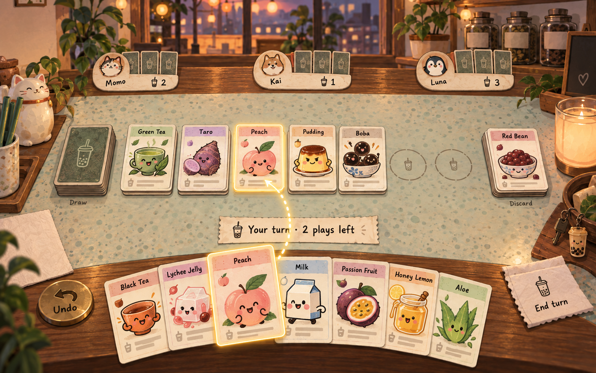
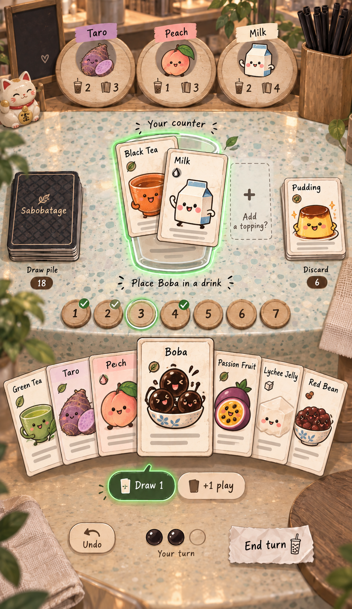
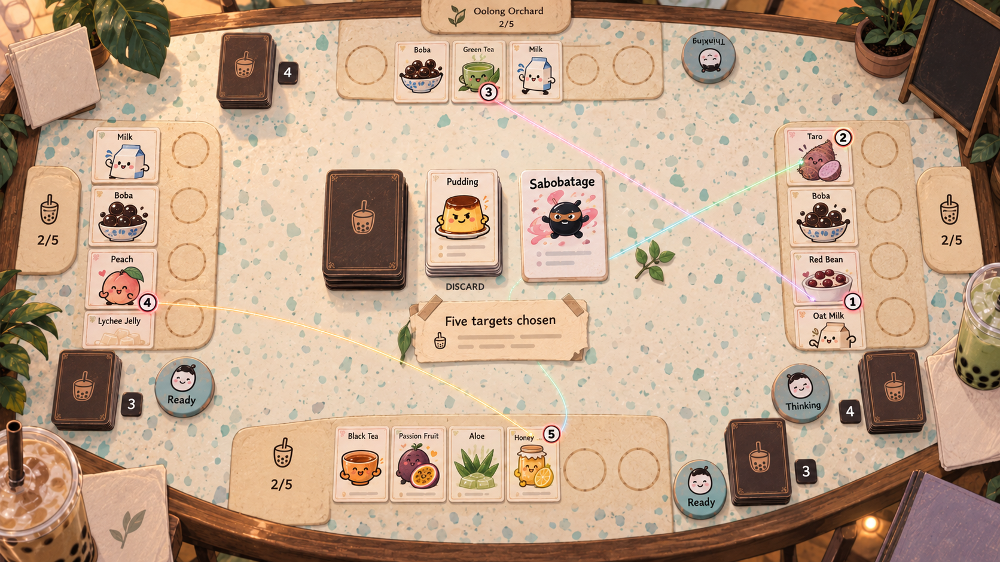

# Sabobatage UX design

**Direction accepted for implementation · October 12, 2026.** The counter-based implementation is now available for visual review; see [actual browser captures and implementation notes](docs/ux/implementation/README.md). The concept paintings below remain composition references, not screenshots.

This design replaces the original functional prototype's scrolling player panels with a boba-shop counter that players manipulate directly. The approved gallery illustrations, larger explanatory text, and original **63:88 portrait card proportions** remain the foundation.

## 1. The table is the interface

You are sitting at a warm, slightly mischievous boba shop. Your hand rests at the near edge. Ingredients accumulate in drink positions on the counter. Other shops occupy stable places across the table. Drawing, stealing, protecting, and discarding visibly move the same physical cards between these places.

The scene should feel like Pantheon's table, translated into Sabobatage's established art direction. It should not feel like a website containing a card game.

| Current prototype problem | Proposed behavior |
| --- | --- |
| Website navigation, heading, instructions, hand, then vertically stacked player sections | A viewport-sized play surface; turn information sits on a small receipt within the scene |
| Finding targets requires scrolling between panels | Stable seats and a focused counter; selecting a shop brings its cards into reach |
| Most UI elements have equal visual weight | Cards dominate; piles, coasters, protection markers, and one contextual instruction support them |
| A horizontal hand strip resembles a content carousel | A near-edge hand fan with individually reachable cards and a raised selection |
| Rules and choices compete with the whole board | Readable inline inspection and choices appear beside the object they affect |
| Desktop layout compressed onto phones | Separate personal desktop, private phone, and public tabletop compositions |

### References and boundaries

The references examined are `../games/pantheon/UX_DESIGN.md`, its `docs/ux/concepts/04-table-desktop.png`, and `src/lib/components/play/TabletopSession.svelte`; and RoboRally's `../games/roborally/src/routes/tt/+page.svelte` and phone/table separation. Pantheon supplies spatial hierarchy, physical card interaction, distinct screen compositions, and visual acceptance discipline. RoboRally supplies stable physical seats and private phone participation.

Some older Pantheon design text describes confirmations and acknowledgement-gated movement. The user's instructions here supersede those details: **no confirmation dialogs; immediate optimistic moves; undo; private hands on phones.** Neither Greek ornament nor an open-handed shared table carries over.

The existing [architecture](docs/architecture.md) remains the technical contract: trusted clients replay immutable Firestore events. This redesign does not introduce a game server, server rule validation, polling, or a network round trip before a card moves.

## 2. Visual direction

Use a quiet mint terrazzo playing surface, a warm wooden near edge, cream paper cards and receipts, and espresso-colored ink. Peach, taro, tea green, and milk cream come from the approved illustrations. Shop scenery lives around the perimeter; the working counter stays calm enough to read cards immediately.

The card characters supply the personality. Do not create another competing cast of mascots. Seat badges can reuse ingredient portraits. Avoid piles of decorative labels, ornamental status panels, and persistent tutorial prose. One-line prompts use ordinary language: “Place Peach in a drink”, “Choose a shop”, “Choose 5 ingredients · 3 chosen”.

All card names, effects, counts, labels, and controls are live HTML. Generated artwork supplies atmosphere and illustration, never baked-in functional text. Preserve the current card artwork and frame; do not redraw the cards to resemble a concept painting. A completed drink remains its constituent ingredient cards, with a small completion stamp. It never becomes a newly invented recipe card or cup illustration.

### Review paintings

These are generated **composition studies**, not screenshots, final UI assets, rule references, or exact layout diagrams. Their lighting, depth, restrained material palette, and card-first composition are the review subject. Implementation must use the actual approved card faces. The geometry and interaction requirements below take precedence over painted details.

#### Personal desktop counter

Borrow the near-edge fan, far-side shops, central work surface, and persistent draw/discard anchors. Correct the painting's simplified central cards into seven positions containing overlapping ingredient stacks. Render opponent hand counts explicitly, rather than relying on the painted number of backs. Use ingredient badges instead of the painting's animal portraits.

#### Private phone hand

Borrow the large focused drink, seven position selectors, reachable hand, and Boba choice beside the selected card. The real phone layout must reserve safe areas and keep controls reachable at 393 × 852 CSS pixels; this taller painting is not permission to scroll the page. Ingredient-category symbols and rules must come from the inventory, not the painting.

#### Shared public table

Borrow the surrounding seat areas and central five-target action, with no face-up private hands. Correct the painting's simplified rows into seven drink positions per player, containing ingredient stacks. Rotate each physical seat's cards and labels toward its player. Target markers belong on the exact ingredient cards, not between them. “Ready”/“Thinking” becomes explicit reaction status; no behavior is inferred from whether a player holds a counter. Decorative shop names are placeholders.

Exact initial and correction prompts are recorded in [docs/ux/prompts.json](docs/ux/prompts.json), generated with the built-in `image_gen.imagegen` tool. These files are review material only and must not be shipped as full-screen raster interfaces.

## 3. Three deliberate compositions

### A. Personal desktop — `/hand/`, 1440 × 1000 baseline

This is a player's private view on a laptop or desktop. It uses the same identity and commands as the phone.

| Region | Content and behavior |
| --- | --- |
| Far edge, approximately 15% of height | Other shop badges, completed-drink totals, hand counts, active-turn marker; select a shop to inspect its counter |
| Middle, approximately 50% | Seven drink positions across your counter; draw pile at left, discard at right; contextual action receipt above the working area |
| Near edge, approximately 35% | Private hand fan; Undo at left, remaining plays and End turn at right; selected card lifts into the working area |

These are composition proportions, not fixed-height panels. Keep a clear central destination area while a card is lifted. All seven local positions stay visible in the resting state. Opponents' public counters can appear in miniature at the far edge, but actionable targets must expand before selection.

Selecting another shop replaces the central counter with that shop's seven positions; the hand remains yours. A persistent owner badge says “Kai's counter” and a nearby “Your counter” affordance restores your view. A steal temporarily carries the selected ingredient above your hand while your counter returns for placement. Do not require scrolling or dragging across a miniature opponent board.

### B. Private phone — `/hand/`, 393 × 852 baseline

The phone is a complete controller and private hand. Players must be able to finish a game without touching the shared display.

Use the space inside device safe areas. As an initial geometry budget for roughly 800 usable vertical pixels: 64 for shop/turn status; 320 for the focused drink and contextual reader; 52 for drink selectors; 240 for the hand; 64 for the action rail; remaining space for separation. Verify actual browser chrome and small-screen behavior before accepting those values.

Show two face-up drinks in the central region, with other drinks folded to the sides using Pantheon's supply coverflow geometry. Swipe or tap a folded drink to bring it forward. Seven numbered coaster selectors beneath it keep every position directly reachable, with complete and targeted states shown by symbols as well as color. Selecting a coaster only browses. Both face-up drinks accept touch drag/drop and tap placement; browsing never commits a move.

The hand fan exposes a disjoint hit area of at least 44 × 44px per card. Seven cards must remain individually selectable; the raised card cannot cover its neighbors' hit areas or the action rail. Cards can extend decoratively behind the safe edge, but their hit areas cannot. For temporarily larger hands, use bounded paging in groups that preserve 44px targets, with visible count and next/previous controls. Do not shrink indefinitely or make the page wider.

Selecting a card raises it and offers applicable destinations. Keep title labels off the hand faces. A labeled Inspect control, long press, or right-click opens a large portrait card and selectable rules without arming a move. Selection is reversible by tapping the card again or using Back. Switching to an opponent uses the same two-drink workspace and seven selectors; an owner label remains visible throughout.

The bottom rail is always reachable: Undo, remaining plays, and the phase's primary action. Contextual choices stay inline. Boba exposes “Draw 1” and “+1 play” before placement; dropping it first remembers the destination and asks for the bonus before committing. Neither choice is silently assumed.

### C. Shared table — `/table/`, 3840 × 2160 physical-table baseline

The shared display shows public play: every drink stack, protection, draw and discard piles, hand counts, current turn, and pending action. **It never renders a private hand face, including in hidden DOM, accessible labels, inspection, animation, or history.** Card backs/counts are sufficient. This is presentation privacy among trusted clients, not encrypted secrecy.

Seats stay fixed for the entire game. With two players use opposite edges; with three use near edge and two far corners; with four use all four edges; with five split the far edge into two seats plus left, right, and near seats. Each seat has seven positions, arranged 4 + 3 when needed. Orient cards and labels toward that seat on a horizontal physical table. A local “Upright display” option makes labels face the audience on a wall display without changing seats or game state.

The central area holds the common piles and action under discussion. Reaction markers appear beside affected shops. Sabobatage shows all five numbered targets together; any connecting lines stay faint and stop at card edges so they do not obscure faces.

With two players, expand both opposing counters across most of the display width and reserve a compact central band for piles and turn status. Do not reuse five-player seat widths and leave most of the screen empty.

During setup, each available seat has a join QR code and short room code. Once seated, the player's shop badge replaces the QR. The host starts from an inline receipt after 2–5 players have joined. No modal setup wizard is needed.

During play, phones issue player commands. Shared-table touches inspect public cards and move the local reading focus only. This deliberately avoids a second ambiguous input device acting as whichever player happens to have the turn. A table inspection reader is anchored at the touched seat and oriented toward it; it never covers the central pending action. Host controls remain on a small edge receipt.

## 4. Cards, drinks, and inspection

### Web multiplayer entry

`/play/` offers two explicit paths: **Play online**, where a named host creates and joins a game in their own browser, and **Play around a table**, which opens the public tabletop. Online hosts share a `/play/?room=…` link or room code, see who has joined, and start once at least two players are present. Each online player uses the personal counter and private hand on their own device. Refresh restores the same identity and room. Neither online creation nor joining redirects to a tabletop or requires a separate phone.

Each regular drink is a stack with exposed Tea, Flavor, and Topping header tabs. Taro drinks contain Taro and Milk/Oat Milk. Show the actual cards, not a substitute recipe illustration. Preserve identity as cards move between stacks. A Wild retains its own artwork and can show a small current-role label when useful; do not ask the player to commit an unnecessary permanent identity.

An empty position is a subtle cup-shaped counter mark. Legal destinations gain a clear outline and text/icon cue when a card is selected. Incompatible positions remain inspectable and can explain “Needs a fruit-compatible topping”; they do not open alerts. Straw appears tucked against its completed drink. Bobasurance appears as a small policy card attached to its drink. Both can be inspected independently.

Playing is tap-card then tap-destination, or pointer drag/drop. On touch, tapping is primary; dragging is optional. Drag previews show the existing card face, the destination slot, and the resulting stack. Releasing outside a legal destination returns the card to its original location without an event. Hover is never required.

Inspection uses a side ledge on desktop and the existing central region on phone. It contains a large card, selectable rules at 16–18px, and relevant recipe/effect explanation. It has no backdrop, focus trap, separate dialog, or confirmation button. Escape or Back restores the prior focus and selection. A bounded public journal and discard reader use the same ledge; only those named readers may scroll internally.

## 5. A turn, without a form

1. The active shop gains a small light and “Your turn”. Touch the draw pile to take the turn's draw; the pile advertises the correct count. Cards move directly into the private hand. Other devices see backs moving and a count update.
2. Select an ingredient and place it in a drink. The card moves immediately, the remaining-play pearls update, and any topping benefit follows the same event's outcome. A completed drink gets a brief stamp, not a celebration dialog.
3. Action cards invite their actual next object: a shop, an ingredient, a drink, or the discard pile. There is no generic “Play selected card” form. Target selection remains reversible until all required choices are made.
4. End turn sits at the near edge. If the hand exceeds seven cards, that location instead says “Discard N to end turn”. Enter this mode, then touch cards to discard them; after reaching seven, End turn becomes available. Discarding and ending are distinct game actions, not a confirmation sequence.
5. End turn advances immediately. The next shop lights up. POS Down stays visibly attached to its shop until the skipped turn arrives, then moves to discard with a brief explanation.

Undo remains in a stable location. It appends an undo event and reverses the latest eligible move's motion. Draw/reveal and turn-end boundaries clear undo eligibility, as described in the existing architecture. When unavailable, show the reason on the control's explanation, for example “New cards were revealed”. Cancelling an unfinished local selection needs no undo event.

## 6. Every action has a concrete interaction

This table specifies all 13 action types in the [27-type, 110-card inventory](src/lib/game/cards.ts). Ingredient compatibility and automatic topping benefits remain governed by the rules model. “Commit” means apply locally and enqueue the immutable event; it never means wait for server approval.

| Card | Gesture and required choices | Commit point / visible result |
| --- | --- | --- |
| Straw | Select, then touch a completed own drink | Destination touch attaches protection; protected drink indicates why attacks cannot target it |
| Bobasurance | Select, then touch an incomplete or complete own drink | Destination touch attaches the policy; when consumed, the policy moves to discard instead of the protected ingredients |
| 5-Star Review | Move card to the draw pile, or select then tap that pile | Draw two into own hand; backs only elsewhere |
| Recycle | Select, then open discard pile in the bounded reader; choose any eligible card there | Touching the chosen discard moves it into hand; do not invent an exclusion for Sabobatage |
| BOGO | Select, then touch another shop's hand-count/back stack | Declares the action; after reactions, a deterministic random hand card transfers and one deck card is drawn; if countered, neither benefit happens |
| POS Down | Select, then touch a shop badge | Declares the target; after reactions, place the reminder at that shop until its skipped turn |
| Lactose Intolerant | Select, then touch a shop | After reactions, that player's phone asks them to touch one Milk on their counter to discard; the attacker does not choose it |
| Untrained Employee | Select, then touch a shop | After reactions, that player touches an incomplete drink to discard; show the Bobasurance substitution when applicable |
| Health Inspector | Select, then touch a topping or flavor card on the chosen shop's counter | Highlight every matching type in that shop before the target touch commits; exclude Wild; after reactions discard the affected copies |
| Sugar and Ice | Select, touch another shop's ingredient, then touch a destination on your counter | Final destination declares the complete steal; after reactions the actual ingredient moves between counters |
| Tea Party | Select up to two teas into a small two-place staging tray; touch your counter to begin placement | Place each staged tea in a drink, or route a non-fitting tea to discard; final placement declares the action. The staging tray offers “Use 1 tea” when only one is chosen; that chooses quantity rather than confirming an already complete action |
| Sabobatage | Touch five distinct eligible ingredients across any counters; numbered markers track choices; touching a chosen target removes it | The fifth target declares all five together and opens reactions. No reaction can occur against an unfinished selection |
| Customer Loyalty | During a reaction, move this card onto the action ticket, or select it and touch that ticket | Counter immediately enters the chain without consuming a normal play; another eligible Loyalty may counter it |

All cards are read using the existing effect text and [rules references](docs/rules-reference.md). This document introduces no new rule, timer, forced choice, or hidden exception. If a needed interaction cannot express the current rules, resolve that explicitly before implementation rather than silently simplifying the game.

### Five targets, then reactions

Sabobatage's initial selection is local UI state. Switching shops retains the numbered selections and the “3 of 5” receipt. The shared display does not leak partial choices. On the fifth valid selection, publish one complete action with all five identities. Every client then shows the same targets before accepting counters.

Each eligible responder sees the pending action in their phone's central region while their hand remains available. They play Customer Loyalty or tap **Pass**. Do not infer a pass from the absence of a counter card; that reveals private information and removes the player's control. There is no countdown. A new counter updates the chain and the applicable response opportunities according to the reducer. Against Sabobatage, show precisely whose targeted ingredients Customer Loyalty saves; do not visually cancel everyone's losses.

```mermaid
stateDiagram-v2
    [*] --> Selecting
    Selecting --> Selecting: Choose or remove a target
    Selecting --> Resting: Cancel local selection
    Selecting --> Reacting: Complete required targets and destinations
    Reacting --> Reacting: Customer Loyalty / next response
    Reacting --> OwnerChoice: Responses complete; victim must choose
    Reacting --> Resolving: Responses complete; no further choice
    OwnerChoice --> Resolving: Victim selects card or drink
    Resolving --> Resting: Move cards and update turn
```

The pending action occupies a small central ticket, not a blocking overlay. Anyone can inspect relevant public cards while waiting. The turn owner cannot start an unrelated move while the action is unresolved. The table names who must respond, for example “Waiting for Taro”; disconnected responders are not silently passed.

## 7. Motion, feedback, and synchronization

Use a consistent source and destination for every movement: deck → hand, hand → drink, shop → shop, table → discard, discard → hand. Normal movement takes roughly 200–350ms; selection lifts take 100–150ms. Keep the hit target at the destination consistent with the optimistic state so fast subsequent input does not wait for animation. Animations can coalesce under rapid play; they cannot serialize game commands.

Apply valid commands immediately using the client reducer. Firestore acknowledgement must not replay their animation. Incoming events animate once; initial load, refresh, and historical replay reconstruct the resting state without reenacting the entire game. Reduced motion uses instant placement and a brief outline instead of travel, rotation, shake, or shimmer.

If an optimistic move becomes invalid after reconciliation, return its card to the valid location and explain the concrete conflict inline: “That ingredient has already moved. Choose another.” Preserve any still-valid local selection. Never leave a duplicate card, stuck loading cover, or misleading remaining-play count.

Connection status belongs on a small edge receipt. “Reconnecting” does not block local inspection. Pending writes retain their identities across retry so the same action cannot happen twice. Do not promise opponents have received a move while disconnected. Technical event IDs, revisions, Firestore terminology, and emulator configuration belong in diagnostics, not the play surface.

## 8. Complete screen and recovery coverage

| State | Required presentation |
| --- | --- |
| Arrival | A restrained shopfront with Create table, Join code, and Continue when an identity has a room; gallery and rules remain separate destinations |
| Gathering players | Public seat QR codes; phone enters shop name inline; joined phone shows its assigned shop and waits; host starts with the required player count |
| Initial deal | Cards arrive at private near edges; shared display shows backs/counts only; no full-screen tutorial |
| Resting / another player's turn | Own hand can be inspected; public counters can be browsed; no misleading enabled play destinations |
| Ingredient or action selected | Raised source card, a single useful prompt, legal destination cues, and a clear local Back affordance |
| Reaction or victim choice | Exact affected cards remain visible; responder controls appear only on the proper phone; table identifies who is needed |
| Hand limit | Required discard count beside hand; individually reachable cards; End turn becomes available only when legal |
| Empty deck / reshuffle | Piles move according to the reducer; counts stay correct; no manual shuffle dialog |
| Refresh / reconnect | Same seat and hand restored from identity and replay; selected local-only gestures may safely reset; no duplicate deal animation |
| Invalid room / lost seat identity | Inline explanation and Join/return path; never expose another player's hand as a fallback |
| Interrupted opponent | Public “Waiting for [shop]”; inspection remains usable; reconnect restores their pending choice; no invented automatic forfeiture |
| Victory | Winning counter receives a restrained stamp and result receipt; final table remains inspectable; Rematch creates a new game rather than overwriting history |

Room management and rematch details are implementation work after design acceptance. Their requirements here are proposed UX, not claims that the current prototype already supports every state.

## 9. Accessibility and visual acceptance

Normal interface and explanatory text starts at 16px; secondary labels may be 14px when they are not needed to take a turn. Inspection rules remain 16–18px or larger. Tiny text printed on a table-scale card is not the only way to learn its effect. Maintain strong ink/paper contrast; verify contrast on the actual textured background.

Every action works with touch, pointer, and keyboard. Interactive card regions are native controls with names containing card, owner, and slot where applicable. Focus order follows shops → working counter → hand → turn controls. Enter/Space selects; Escape cancels local selection or closes an inline reader. Dragging always has a tap/keyboard equivalent. Never announce an opponent's hidden card identity.

Use at least 44 × 44px disjoint targets, preferably 48px for primary actions. Selected, legal, protected, complete, and targeted states use outlines, symbols, and words in addition to color. Provide reduced motion and no essential sound. At 150% text size, prioritize readable controls and bounded readers over decorative scenery; do not clip rules or hide End turn.

### Acceptance captures and interaction fixtures

After this design is accepted, establish actual browser screenshot baselines following Pantheon's discipline. The paintings are not pixel baselines. Capture with stable seed, fonts, viewport, and reduced motion; review changes deliberately rather than widening tolerances or masking broken regions.

| Fixture | Required check |
| --- | --- |
| Phone 393 × 852 and compact 360 × 740 | No body overflow; seven hand cards have disjoint targets; seven drink selectors fit; selected card, rules, and phase action remain usable with safe areas |
| Personal desktop 1440 × 1000 | Own seven positions, hand, piles, and Undo/End turn fit together; switching opponent never confuses ownership |
| Shared table 3840 × 2160, DPR 1 | Five seats × seven occupied positions remain identifiable; orientations match seats; no hand faces anywhere |
| Public display 1440 × 1000 | Upright mode preserves seats and readable action/turn status; public inspection can enlarge card details |
| Temporary hand of 14; large discard pile | Bounded hand paging and discard reader work without shrinking hit targets or moving the page |
| Sabobatage across three shops | Selections 1–4 remain local; fifth reveals all together; counter chain and per-player protection stay understandable |
| Lactose / Employee victim choice | Only the target makes the choice; table and other phones show the waiting state accurately |
| Steal, topping bonus, Wild, Straw, Bobasurance | Source/destination and changed state are visible; card identity and actual protection semantics remain intact |
| Optimistic play, acknowledgement, competing move, retry | Immediate local movement; no double animation or duplicate event; invalidated intent recovers inline |
| Undo, refresh, reduced motion, enlarged text | Correct state and identity; no replay of history; equivalent interaction without movement or tiny text |

Also audit the public projection's DOM, accessibility tree, journal, and animations for hand-face leaks. Preserve the complete gallery's 27 types / 110 copies and the 63:88 card silhouette. Existing rules/replay tests remain necessary but do not constitute visual approval.

## 10. Implementation sequence after review

1. Approve the spatial direction: the quiet illustrated counter, the phone's focused drink and private fan, and fixed public seats. Review the three paintings with their stated corrections.
2. Build static compositions with the real card component and deterministic fixture states at all baseline sizes. Review actual screenshots before wiring every interaction. Remove gameplay website chrome and vertical player-panel composition.
3. Implement selection, inspection, ingredient placement, hand overflow, and turn controls with tap, keyboard, and drag equivalents. Keep the existing reducer and event architecture.
4. Implement every action row above, especially the five-target staging, per-player reactions, target-player discard choices, and steals between focused counters.
5. Complete public projection, oriented seats, join/reconnect, motion, undo feedback, and victory. Run gameplay, privacy, accessibility, and visual acceptance fixtures.

**Review boundary:** the user approved proceeding with implementation. This branch now includes the counter-based UI and actual browser captures. The next review concerns the implemented screens and interactions; the generated concept paintings are not pixel baselines.
