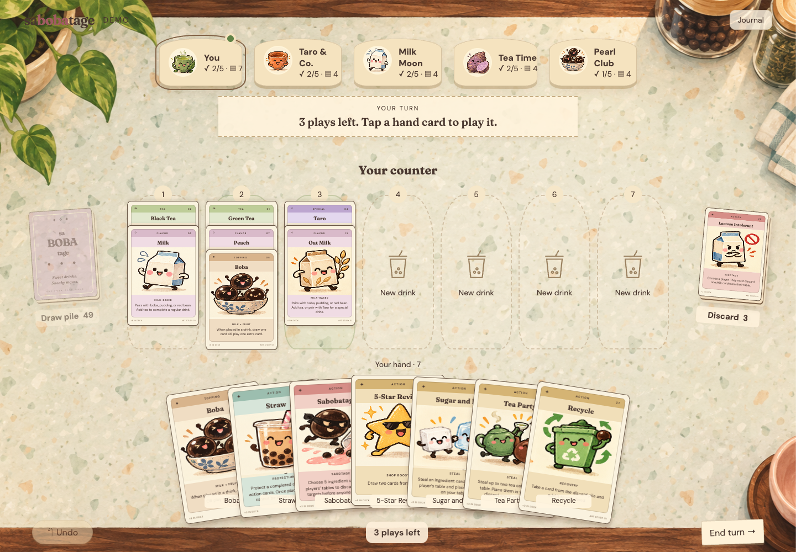
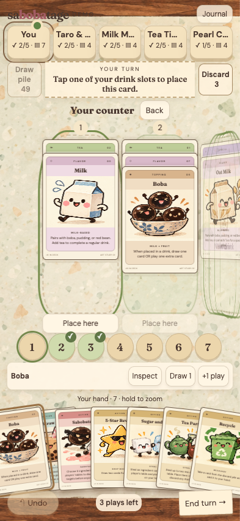
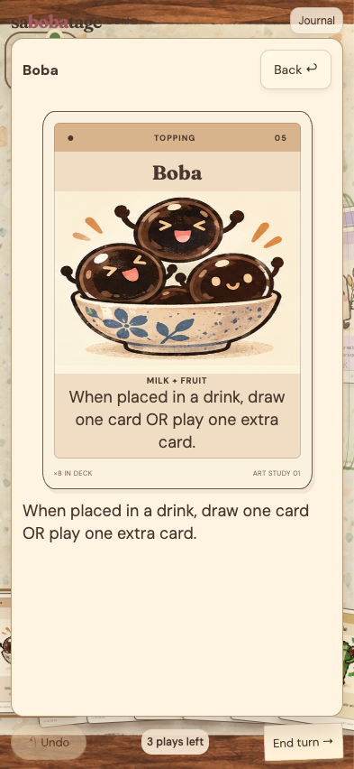
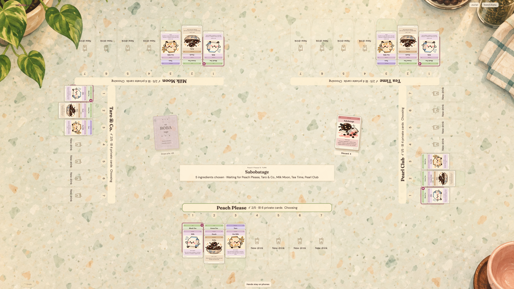
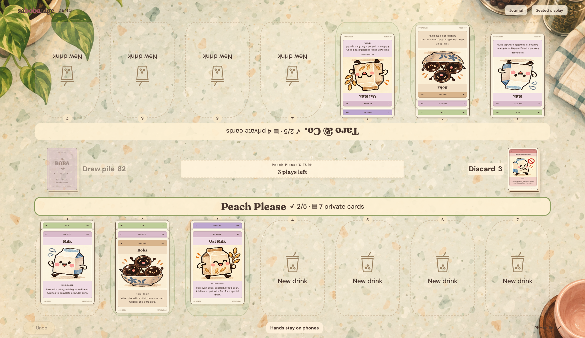

# Counter UX implementation

These are browser captures of the implemented Svelte UI, using the actual approved card artwork and deterministic development fixtures. They are not generated mockups or approved pixel baselines.

## Personal desktop

Seven positions share one working counter. Shop coasters switch the counter owner without changing whose hand is shown. The near-edge fan has disjoint button regions; selecting a card raises its artwork while keeping adjacent cards reachable. Draw and discard remain spatial anchors.

## Private phone

The phone shows two face-up drinks using Pantheon's supply coverflow geometry. Swipe the counter, tap a folded drink, or use the seven numbered selectors to browse. Selecting a number only changes focus. Drag a hand card onto either face-up drink or tap the card and its destination. Pointer events support actual touch dragging; the viewport and hand do not scroll. Invalid or cancelled drags write no event. Dropping Boba offers its two inline bonus choices before committing the placement.

The hand no longer has duplicate title labels over the artwork. Hold or right-click any card to zoom without selecting a move; a selected card also has an explicit Inspect button. The large portrait face and selectable rules occupy an inline reader, with Back or Escape returning to the prior selection.

## Public tabletop

The table shows public ingredient stacks, hand counts, and all declared targets. Seats stay fixed; Upright display changes reading orientation only. Public card inspection opens at the selected seat. Phones own player moves. The host retains event-backed Undo.

Two players use 88% of the table width for each opposing counter, with larger cards and a compact central band for piles and turn status. Five-player seat geometry remains unchanged. The active surface fills the display, including screens wider than the old page-width cap.

## Interaction and verification

The implementation preserves optimistic local commands and immutable Firestore replay. It adds no game server or confirmation dialogs. Staged Sabobatage targets stay local until the fifth choice. Tea Party stages its quantity before destinations; stealing returns focus to the player's own counter; Lactose Intolerant leaves the Milk choice with its victim. Readers and oversized hands have bounded scrolling/paging instead of page overflow.

Browser coverage checks Boba placement and undo, draw-pile activation, five-target declaration, Sugar and Ice, two-tea placement, Straw, victim choice, recycling, a fourteen-card hand, phone/desktop bounds, readable inspection, and public-table privacy. Touch-device tests send real browser touch events for drag placement on both face-up drinks, long-press zoom, cancelled/invalid drops, and coverflow swipes. Two-player geometry checks card size and bounds; five-player checks retain disjoint seats. An emulator-backed browser test creates a real room with two independent phone identities and checks synchronization, undo, and reload recovery. Existing reducer, replay, and Firestore tests remain in place.

The scene background is a decorative generated bitmap at [`static/art/shop-counter.png`](../../../static/art/shop-counter.png); all cards, labels, counts, and controls are HTML. Its exact [prompt](../background-prompt.json) records use of the built-in `image_gen.imagegen` tool.

This pass implements the principal compositions and playable interaction flows. Opening `/table/` now creates the room directly and displays phone-join codes facing all four edges, with joined shops and start controls in the center. The codes share a room link rather than reserving individual seats. Reloading the resulting URL restores that room. Rematch opens a new table and uses its join flow. Motion tracks cards that are visible at both endpoints; elaborate hidden-card deal/steal choreography remains a later visual refinement. These distinctions do not change the game rules or synchronization model.
